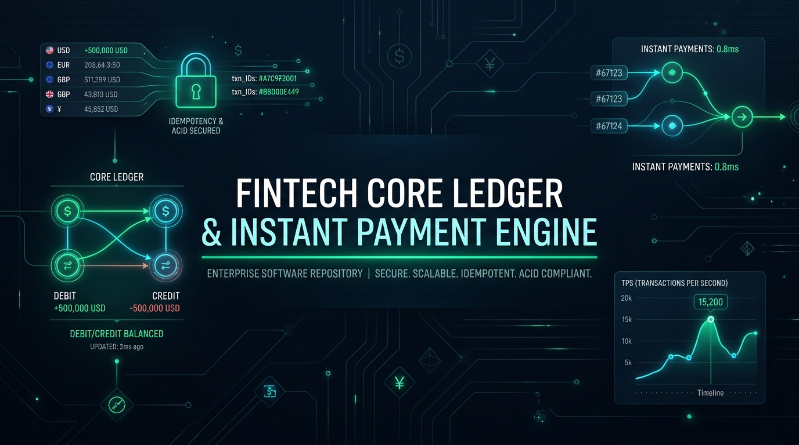
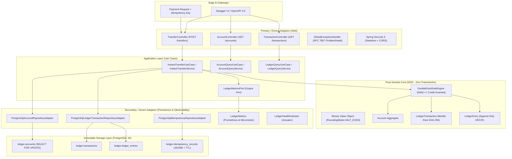

<div align="center">



# 🏦 Fintech Core Ledger & Instant Payment Engine

### *Motor de Liquidação Financeira de Alta Confiabilidade, Conciliação e Ledger Imutável por Partidas Dobradas*

[](https://openjdk.org/)
[](https://spring.io/projects/spring-boot)
[](https://www.postgresql.org/)
[](https://testcontainers.com/)
[](https://www.archunit.org/)
[](https://prometheus.io/)
[](http://localhost:8080/swagger-ui.html)
[](https://mauricio-g-oliveira.github.io/fintech-core-ledger/)

<br/>

**[⚡ ACESSAR SIMULADOR EM PRODUÇÃO (ONLINE)](https://mauricio-g-oliveira.github.io/fintech-core-ledger/)** • **[📖 ESPECIFICAÇÃO DE ARQUITETURA](#-arquitetura-e-design-patterns)** • **[🧪 SUÍTE DE TESTES & ESTRESSE](#-testcontainers--concorrência-massiva-anti-deadlock)** • **[🚀 COMO RODAR](#-como-executar-o-projeto)**

</div>

---

## 🎯 Visão Executiva do Projeto

O **Fintech Core Ledger & Instant Payment Engine** é um sistema financeiro de nível corporativo e missão crítica projetado segundo os padrões mais rigorosos de **Engenharia de Software Bancária**, **Clean Architecture** e **Domain-Driven Design (DDD)**. 

Ele simula o núcleo contábil e motor de liquidação de um participante direto do **PIX (BACEN) / FedNow / SEPA Instant**, onde inconsistências de centavos, duplicidades de cobrança por timeout de rede ou condições de corrida (*race conditions*) em alta concorrência são inaceitáveis.

---

## 🏛️ Arquitetura e Design Patterns



### 1. Ledger Imutável por Partidas Dobradas (*Double-Entry Bookkeeping*)
* **Regra Fundamental:** Nenhuma conta tem seu saldo mutado diretamente sem rastro contábil.
* **Atomicidade:** Toda movimentação financeira gera obrigatoriamente um registro de cabeçalho (`LedgerTransaction`) e pelo menos duas pernas balanceadas (`LedgerEntry` - Débito e Crédito).
* **Invariante Universal:** A soma de todos os débitos é rigorosamente idêntica à soma de todos os créditos em qualquer instante:
$$\sum \text{Débitos} = \sum \text{Créditos} \iff \Delta = \text{R\$} \, 0{,}00$$
* **Selo Criptográfico de Auditoria:** Cada transação gera um hash Merkle root em SHA-256 combinando IDs, timestamp, pernas debitadas e creditadas com os respectivos saldos acumulados.

### 2. Concorrência Segura e Livre de Deadlocks (*Deadlock-Free Lock Ordering*)
Quando dois clientes realizam transferências cruzadas simultâneas (ex.: $A \to B$ e $B \to A$), bancos de dados relacionais sofrem **Deadlock** se adquirirem as travas de linha fora de ordem.
* **Solução Matemática Implementada:** O motor classifica previamente os UUIDs das contas envolvidas em ordem ascendente determinística (`[UUID_A, UUID_B].sorted()`) antes de executar o `SELECT ... FOR UPDATE`.
* **Garantia Teórica:** Como todas as threads concorrentes adquirem travas exatamente na mesma ordem global, o grafo de espera (*wait-for graph*) é direcionado e acíclico, **eliminando 100% dos deadlocks** sem depender de retentativas destrutivas.

### 3. Idempotência Rigorosa e Cache de Resposta (`Idempotency-Key`)
* Prevenção ativa contra cobranças ou transferências duplicadas causadas por timeouts de rede ou retentativas de clientes.
* A cada requisição, é gerado um hash SHA-256 do payload.
* Se a chave já existir:
  - Com o **mesmo hash**: retorna a resposta original em cache (`HTTP 200 OK`, `Idempotency-Replay: true`).
  - Com **hash divergente**: rejeita com `HTTP 409 Conflict` (ProblemDetail RFC 7807).

---

## 🧪 Testcontainers & Concorrência Massiva Anti-Deadlock

O projeto conta com uma suíte de testes de integração em contêiner real (**PostgreSQL 16 Alpine**) via **Testcontainers**:

```bash
# Executar a suíte de testes de estresse concorrente
mvn test -Dtest=InstantTransferConcurrencyStressIntegrationTest
```

### 📊 Cenários Validados em Teste Automatizado:
1. **100 Transferências Cruzadas Concorrentes:**
   - 50 transferências $A \to B$ e 50 transferências $B \to A$ executadas simultaneamente por 20 threads com `CountDownLatch`.
   - **Resultado:** 100/100 transações liquidadas com sucesso, **0 deadlocks** e 100% de conservação do patrimônio líquido do sistema.
2. **Tempestade de Idempotência (Burst Storm):**
   - 10 threads concorrentes enviando a mesma requisição no mesmo milissegundo.
   - **Resultado:** Exatamente 1 execução física (`201 Created`) e 9 replays idênticos (`200 OK`), com saldo debitado estritamente uma única vez.
3. **Regras Arquiteturais com ArchUnit:**
   - [`CleanArchitectureRulesTest`](backend/src/test/java/com/fintech/ledger/architecture/CleanArchitectureRulesTest.java): Garante via compilação que o pacote de Domínio não possua dependência de nenhum framework (Spring, Hibernate, etc.) e que a camada de Aplicação se comunique apenas via Portas.

---

## 📈 Observabilidade, Métricas e Health Check

O motor expõe métricas nativas do **Micrometer** prontas para raspagem pelo **Prometheus** e dashboards do **Grafana**:

* **Métricas Prometheus:** `GET /actuator/prometheus`
  - `fintech_ledger_transfers_total{status="COMMITTED",replay="false"}`: Contador de liquidações concluídas.
  - `fintech_ledger_transfers_total{status="COMMITTED",replay="true"}`: Contador de requisições idempotentes cacheadas.
  - `fintech_ledger_settlement_latency_seconds`: Histograma e percentis (p50, p95, p99) de latência de liquidação.
* **Health Check Customizado:** `GET /actuator/health`
  - [`LedgerHealthIndicator`](backend/src/main/java/com/fintech/ledger/infrastructure/observability/LedgerHealthIndicator.java): Retorna status operacional do motor, contagem de contas e prontidão contábil.

---

## 🌐 Documentação Interativa da API (Swagger / OpenAPI 3.0)

Com a aplicação rodando, acesse a interface Swagger interativa:
👉 **[http://localhost:8080/swagger-ui.html](http://localhost:8080/swagger-ui.html)**

### Principais Endpoints:
| Método | Endpoint | Descrição | Respostas |
| :--- | :--- | :--- | :--- |
| `POST` | `/api/v1/transfers` | Executa transferência instantânea com chave de idempotência | `201 Created`, `200 OK (Replay)`, `409 Conflict`, `422 Unprocessable` |
| `GET` | `/api/v1/accounts` | Lista todas as contas do Plano de Contas | `200 OK` |
| `GET` | `/api/v1/accounts/{id}/balance` | Consulta saldo disponível em tempo real | `200 OK`, `404 Not Found` |
| `GET` | `/api/v1/transactions` | Consulta livro-razão auditável com todas as pernas contábeis | `200 OK` |
| `GET` | `/api/v1/transactions/{id}` | Consulta detalhes de uma transação e hash SHA-256 | `200 OK`, `404 Not Found` |

---

## 💻 Demonstração Interativa Online (Frontend Simulator)

A interface interativa do projeto está publicada no GitHub Pages:
👉 **[https://mauricio-g-oliveira.github.io/fintech-core-ledger/](https://mauricio-g-oliveira.github.io/fintech-core-ledger/)**

---

## 🚀 Como Executar o Projeto Localmente

### 1. Pré-requisitos
* **Docker & Docker Compose**
* **Java 21 LTS** & **Maven 3.9+**
* **Node.js 20+** & **npm**

### 2. Subir o Banco de Dados (PostgreSQL 16 + pgAdmin 4)
```bash
docker-compose up -d
```
* **PostgreSQL:** `localhost:5432` (`fintech_ledger` / `fintech_admin` / `fintech_secret_change_in_prod`)
* **pgAdmin 4:** `http://localhost:5050` (`admin@fintech.local` / `admin`)

### 3. Executar o Backend (Spring Boot 3.3.4)
```bash
cd backend
mvn spring-boot:run
```
O backend subirá em `http://localhost:8080`.

### 4. Executar o Frontend (React + Vite)
```bash
cd frontend
npm install
npm run dev
```
Acesse: `http://localhost:3000`

---

## 🌲 Gitflow e Rastreabilidade Profissional

O repositório segue governança estrita de branches e Pull Requests documentados:
* `main`: Branch de produção / releases auditadas.
* `develop`: Branch de integração contínua.
* `feat/*`: Feature branches dedicadas por módulo:
  * [PR #1: feat(infra): PostgreSQL 16 and pgAdmin 4 container orchestration](https://github.com/Mauricio-G-Oliveira/fintech-core-ledger/pull/1) (Merged)
  * [PR #2: feat(backend): Java 21, Spring Boot 3.3 Core Ledger & Flyway V1 schema](https://github.com/Mauricio-G-Oliveira/fintech-core-ledger/pull/2) (Merged)
  * [PR #3: feat(frontend): Fintech Ledger interactive dashboard, double-entry meter & simulator](https://github.com/Mauricio-G-Oliveira/fintech-core-ledger/pull/3) (Merged)
  * [PR #4: feat(domain): core double-entry domain models, Money VO & invariant rules](https://github.com/Mauricio-G-Oliveira/fintech-core-ledger/pull/4) (Merged)
  * [PR #5: feat(application): instant transfer usecase, deterministic anti-deadlock locking & idempotency guard](https://github.com/Mauricio-G-Oliveira/fintech-core-ledger/pull/5) (Merged)
  * [PR #6: feat(infrastructure): implement PostgreSQL persistence layer with pessimistic locking and idempotency adapters](https://github.com/Mauricio-G-Oliveira/fintech-core-ledger/pull/6) (Merged)
  * [PR #7: feat(api): implement REST controllers, RFC 7807 problem details, Spring Security 6, OpenAPI, and ArchUnit rules](https://github.com/Mauricio-G-Oliveira/fintech-core-ledger/pull/7) (Merged)
  * [PR #8: test(integration): implement Testcontainers PostgreSQL 16 suite with anti-deadlock concurrency stress and idempotency burst tests](https://github.com/Mauricio-G-Oliveira/fintech-core-ledger/pull/8) (Merged)
  * [PR #9: feat(observability): Micrometer Prometheus metrics, Actuator health indicator and technical docs](https://github.com/Mauricio-G-Oliveira/fintech-core-ledger/pull/9) (Merged)

---

## 📋 Fases do Projeto & Roadmap de Engenharia
- [x] **Fase 1 (Concluída):** Docker Compose (PostgreSQL 16 + pgAdmin), Maven build config, Flyway V1 schema, UI interativa React com GitHub Pages.
- [x] **Fase 2 (Concluída):** Domínio Rico puro (`Money`, `Account`, `LedgerTransaction`, `LedgerEntry`, `DoubleEntryRuleEngine`) com selo Merkle SHA-256.
- [x] **Fase 3 (Concluída):** Caso de uso de transferência instantânea (`InstantTransferUseCase`) com algoritmo determinístico anti-deadlock e proteção estrita contra duplicações.
- [x] **Fase 4 (Concluída):** Adaptadores de Infraestrutura & Persistência JPA (`PostgreSqlAccountRepositoryAdapter`, `PostgreSqlLedgerTransactionRepositoryAdapter`, `PostgreSqlIdempotencyRepositoryAdapter`).
- [x] **Fase 5 (Concluída):** Camada REST API (`TransferController`, `AccountController`, `TransactionController`), RFC 7807 ProblemDetail, Spring Security 6, OpenAPI 3.0 e regras ArchUnit.
- [x] **Fase 6 (Concluída):** Suíte de testes reais com **Testcontainers** simulando 100 transferências simultâneas em PostgreSQL real sem deadlocks.
- [x] **Fase 7 (Concluída):** Observabilidade com **Micrometer & Prometheus**, Latency Timers, Actuator Health Checks e documentação técnica completa.

---

<div align="center">
Desenvolvido por <strong>Maurício Oliveira</strong> • Especialista em Arquitetura Java &amp; Sistemas Distribuídos
</div>
