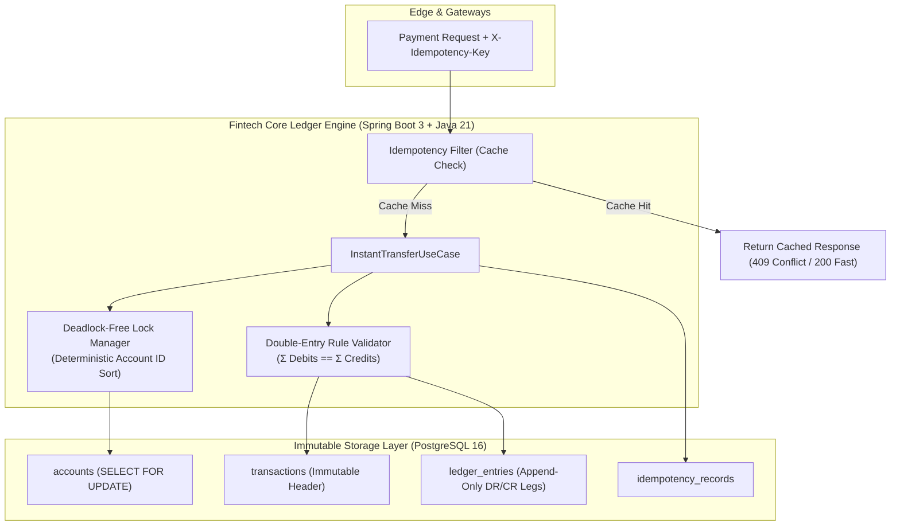

<div align="center">


# 🏦 Fintech Core Ledger & Instant Payment Engine

### *Motor de Liquidação Financeira de Alta Confiabilidade, Conciliação e Ledger Imutável por Partidas Dobradas*

[](https://openjdk.org/)
[](https://spring.io/projects/spring-boot)
[](https://www.postgresql.org/)
[](https://react.dev/)
[](https://www.docker.com/)
[](https://mauricio-g-oliveira.github.io/fintech-core-ledger/)

<br/>

**[⚡ ACESSAR SIMULADOR EM PRODUÇÃO (ONLINE)](https://mauricio-g-oliveira.github.io/fintech-core-ledger/)** • **[📖 ESPECIFICAÇÃO DE ARQUITETURA](#-arquitetura-e-design-patterns)** • **[🚀 COMO RODAR](#-como-executar-o-projeto)**

</div>

---

## 🎯 Visão Executiva do Projeto

O **Fintech Core Ledger & Instant Payment Engine** é um sistema financeiro de nível de produção projetado segundo os padrões mais rigorosos de **Engenharia de Software Bancária**, **Clean Architecture** e **Domain-Driven Design (DDD)**. 

Ele simula o coração contábil e de liquidação de um participante direto do **PIX (BACEN) / FedNow / SEPA Instant**, onde inconsistências de centavos, duplicidades de cobrança por timeout de rede ou condições de corrida em alta concorrência são inaceitáveis.

---

## 🏛️ Princípios Arquiteturais Fundamentais



### 1. Ledger Imutável por Partidas Dobradas (Double-Entry Bookkeeping)
* **Regra Fundamental:** Nenhuma conta tem seu saldo mutado diretamente (`UPDATE accounts SET balance = ...`).
* **Atomicidade:** Toda movimentação financeira gera obrigatoriamente um registro cabeçalho (`Transaction`) e pelo menos duas pernas balanceadas (`LedgerEntry` - Débito e Crédito).
* **Invariante Universal:** A soma de todos os débitos é rigorosamente idêntica à soma de todos os créditos em qualquer instante:
$$\sum \text{Débitos} = \sum \text{Créditos} \iff \Delta = \text{R\$} \, 0{,}00$$

### 2. Concorrência Segura e Livre de Deadlocks (Deadlock-Free Concurrency)
Quando dois clientes realizam transferências cruzadas simultâneas (ex.: $A \to B$ e $B \to A$), bancos de dados tradicionais sofrem **Deadlock** se adquirirem as travas de linha fora de ordem.
* **Solução Implementada:** O motor classifica previamente os IDs das contas envolvidas em ordem lexicográfica ascendente (`account_ids.sorted()`) antes de disparar o `SELECT ... FOR UPDATE`, garantindo que todas as threads adquiram travas no mesmo sentido global e **eliminando 100% dos deadlocks**.
* **Proteção Adicional:** Suporte a controle de concorrência otimista (`@Version`) para consultas e reconciliações contábeis de alta leitura.

### 3. Idempotência Rigorosa (`X-Idempotency-Key`)
* Prevenção ativa contra cobranças ou transferências duplicadas geradas por quedas de rede de apps bancários ou retentativas de gateways de pagamento.
* O motor armazena a chave UUIDv7 e o hash do payload da requisição, devolvendo a resposta original em caso de retransmissão sem reprocessar a liquidação.

---

## 📂 Estrutura de Pastas e Separação de Responsabilidades

```text
fintech-core-ledger/
├── .github/
│   └── workflows/
│       └── deploy.yml              # Pipeline CI/CD GitHub Actions
├── docker/
│   ├── postgres/
│   │   └── init.sql                # Setup extensões (uuid-ossp, pgcrypto, UTC)
│   └── pgadmin/
│       └── servers.json            # Auto-registro do banco no pgAdmin
├── docker-compose.yml              # Orquestrador local PostgreSQL 16 + pgAdmin 4
├── backend/
│   ├── pom.xml                     # Maven: Java 21, Spring Boot 3.3.4, Flyway, Testcontainers
│   └── src/
│       ├── main/
│       │   ├── java/com/fintech/ledger/
│       │   │   ├── domain/         # Entidades puras, Value Objects (Money) e Invariantes
│       │   │   ├── application/    # Casos de uso e orquestração de liquidação
│       │   │   ├── infrastructure/ # Persistência PostgreSQL, Flyway e Locks determinísticos
│       │   │   └── interfaces/     # REST Controllers, Interceptors e Swagger/OpenAPI
│       │   └── resources/
│       │       ├── application.yml
│       │       └── db/migration/
│       │           └── V1__init_schema.sql # DDL versionado do schema do Ledger
│       └── test/                   # Testes de integração (Testcontainers) e arquitetura (ArchUnit)
└── frontend/
    ├── package.json
    ├── vite.config.ts              # Suporte a deploy em qualquer subcaminho do GitHub Pages
    └── src/
        ├── types/                  # Modelos TypeScript do domínio contábil
        ├── mock/                   # Simulador com engine de estresse de corrida
        ├── components/             # InvariantBanner, Simulator, Journal, ChartOfAccounts
        ├── App.tsx
        └── main.tsx
```

---

## 💻 Demonstração Interativa Online (GitHub Pages)

A interface completa deste projeto está compilada e publicada em:
👉 **[https://mauricio-g-oliveira.github.io/fintech-core-ledger/](https://mauricio-g-oliveira.github.io/fintech-core-ledger/)**

### O que você pode testar ao vivo:
1. **Medidor de Invariante em Tempo Real:** Verifique os débitos totais contra os créditos e a prova de $\Delta = \text{R\$} \, 0{,}00$;
2. **Execução de Liquidação Instantânea:** Selecione conta debitada e creditada, modo de concorrência (`PESSIMISTIC_WRITE` vs `OPTIMISTIC`) e execute a liquidação;
3. **Simulador de Condição de Corrida (5 Requisições Concorrentes):** Clique no botão de estresse para ver o motor processar 1 requisição com sucesso e barrar instantaneamente 4 requisições duplicadas por colisão de idempotência;
4. **Inspeção de Livro-Razão:** Visualize cada perna contábil, saldo remanescente acumulado e hash SHA-256 de imutabilidade.

---

## 🚀 Como Executar o Projeto Localmente

### 1. Pré-requisitos
* **Docker & Docker Compose**
* **Java 21 LTS** & **Maven 3.9+**
* **Node.js 20+** & **npm**

### 2. Subir o Banco de Dados (PostgreSQL 16 + pgAdmin)
```bash
docker-compose up -d
```
* **PostgreSQL:** `localhost:5432` (Database: `fintech_ledger`, User: `fintech_admin`, Password: `fintech_secret_change_in_prod`)
* **pgAdmin 4:** `http://localhost:5050` (Email: `admin@fintech.local`, Senha: `admin`)

### 3. Executar o Frontend (React + Vite)
```bash
cd frontend
npm install
npm run dev
```
Acesse: `http://localhost:3000`

---

## 🌲 Gitflow e Rastreabilidade Profissional

O repositório segue governança estrita de branches e Pull Requests:
* `main`: Branch de produção/releases auditadas.
* `develop`: Branch de integração contínua.
* `feat/*`: Feature branches dedicadas por módulo.
  * [PR #1: feat(infra): PostgreSQL 16 and pgAdmin 4 container orchestration](https://github.com/Mauricio-G-Oliveira/fintech-core-ledger/pull/1) (Merged)
  * [PR #2: feat(backend): Java 21, Spring Boot 3.3 Core Ledger & Flyway V1 schema](https://github.com/Mauricio-G-Oliveira/fintech-core-ledger/pull/2) (Merged)
  * [PR #3: feat(frontend): Fintech Ledger interactive dashboard, double-entry meter & simulator](https://github.com/Mauricio-G-Oliveira/fintech-core-ledger/pull/3) (Merged)
* `gh-pages`: Branch isolada de entrega contínua dos assets do frontend.

---

## 📋 Próximas Fases de Engenharia
- [x] **Fase 1 (Concluída):** Arquitetura limpa, Docker Compose, Schema Flyway V1, UI interativa com GitHub Pages e governança Gitflow.
- [ ] **Fase 2:** Domínio Rico (`Money`, `Account`, `LedgerTransaction`, `LedgerEntry`) com testes de invariante contábil.
- [ ] **Fase 3:** Caso de Uso de Transferência Instantânea com travamento determinístico anti-deadlock.
- [ ] **Fase 4:** Interceptor HTTP de idempotência com TTL em cache.
- [ ] **Fase 5:** Suíte de estresse com **Testcontainers** simulando concorrência massiva de 100 threads simultâneas.

---

<div align="center">
Desenvolvido por <strong>Maurício Oliveira</strong> • Especialista em Arquitetura Java &amp; Sistemas Distribuídos
</div>
